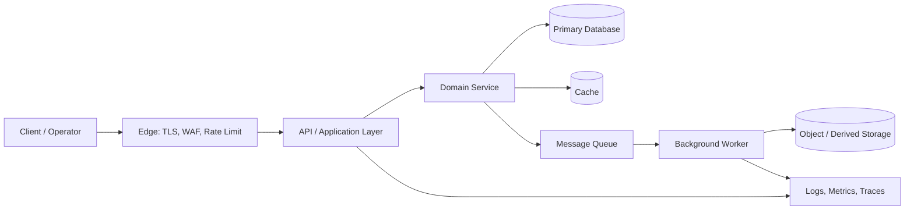

# Day 45: Ride-Hailing Platform: End-to-End Case Study

**Track:** Use-Cases  
**Outcome:** Design matching, location updates, trip lifecycle and pricing boundaries.  
**Core concepts:** geospatial index; location stream; dispatch; state machine.

## 1. Problem and engineering context

A city ride service matches nearby drivers while handling stale GPS positions. The first design task is to clarify the system boundary: identify who initiates the operation, which data is authoritative, which external dependencies exist, and what must happen synchronously before the user receives a response. Avoid choosing a database, framework or cloud service before these questions are answered.

A useful design starts with the simplest architecture that meets the stated constraints. Write down expected traffic, data sensitivity, consistency requirements, latency expectations and operational ownership. Treat estimates as assumptions, label them, and revisit them when evidence becomes available. A design is not “scalable” merely because it contains fashionable components; every added component should solve a named bottleneck or risk.

## 2. Requirements and quality attributes

**Functional requirements**
- A user or trusted system can initiate the primary workflow described above.
- The system validates input, enforces authorization and records the resulting state.
- Operators can inspect status, diagnose failures and safely retry recoverable work.
- The product exposes a stable interface to its clients and dependent systems.

**Non-functional requirements**
- **Latency:** define a target for the interactive path and move long-running work to asynchronous processing.
- **Availability:** identify critical dependencies and define degraded behavior when each is unavailable.
- **Durability:** persist accepted business events before acknowledging success.
- **Security:** authenticate callers, authorize each resource access and minimize sensitive data exposure.
- **Maintainability:** keep domain rules testable and document decisions that are expensive to reverse.

Before implementation, turn vague words such as “fast” or “secure” into measurable targets. For example, a team might initially propose p95 API latency below 300 ms for metadata reads, 99.9% monthly availability for the core API, and a defined recovery point for durable records. These are example targets, not universal guarantees; validate them against the product's needs and budget.

## 3. Proposed architecture



The interactive request should perform authentication, validation and the minimum durable state transition. Work that can be delayed—notifications, indexing, analytics, media processing or external integrations—belongs behind a queue. The database remains the source of truth for business state; caches and search indexes are derived representations and must be rebuildable.

Keep the initial deployment small: one application service, one primary database and a queue only when asynchronous work is genuinely required. Introduce independent services when scaling, security isolation, deployment cadence or team ownership justify the network and operational complexity. The diagram is a logical view; a small deployment may run several boxes in one process.

## 4. Data model and persistence

A practical baseline schema is:

```sql
CREATE TABLE accounts (
    id            UUID PRIMARY KEY,
    email         TEXT NOT NULL UNIQUE,
    status        TEXT NOT NULL,
    created_at    TIMESTAMPTZ NOT NULL DEFAULT now()
);

CREATE TABLE resources (
    id            UUID PRIMARY KEY,
    account_id    UUID NOT NULL REFERENCES accounts(id),
    status        TEXT NOT NULL,
    payload       JSONB NOT NULL DEFAULT '{}',
    version       BIGINT NOT NULL DEFAULT 1,
    created_at    TIMESTAMPTZ NOT NULL DEFAULT now(),
    updated_at    TIMESTAMPTZ NOT NULL DEFAULT now()
);

CREATE INDEX idx_resources_account_created
    ON resources (account_id, created_at DESC);
```

This is a teaching baseline, not a claim that every domain should use these exact entities. Replace generic `resources` with domain-specific tables, add foreign keys and check constraints for invariants, and store only fields that have a clear purpose. Use transactions for state changes that must succeed or fail together. Add an audit/event table when the product needs traceability; avoid treating mutable application logs as the only business history.

For high-volume or flexible data, choose storage by access pattern rather than fashion. Keep transactional records in a relational database unless a concrete requirement points elsewhere. Store large files in object storage and keep metadata plus a stable object key in the database. Derived search/vector indexes should carry source identifiers and version information so they can be refreshed after source changes.

## 5. API contract

Example resource-oriented contract (adapt names and fields to the domain):

```http
POST /v1/resources
Authorization: Bearer <access-token>
Idempotency-Key: 7f9d...
Content-Type: application/json

{
  "payload": {"source": "web", "description": "example"}
}
```

```json
{
  "id": "resource_uuid",
  "status": "accepted",
  "created_at": "2026-01-01T10:00:00Z"
}
```

Recommended companion endpoints:
- `GET /v1/resources/{id}` — read one authorized resource.
- `GET /v1/resources?cursor=...&limit=20` — cursor-paginated listing.
- `PATCH /v1/resources/{id}` — partial update with version/ETag checks.
- `GET /health/live` and `GET /health/ready` — process liveness and dependency readiness.

Return consistent error objects with a machine-readable `code`, safe `message`, request ID and optional field errors. Use `201 Created` for completed synchronous creation or `202 Accepted` when a durable job has been queued. Validate pagination limits, reject unknown state transitions and never expose stack traces or internal secrets to clients.

## 6. Data flow and state transitions

1. The client sends a request over TLS with an authenticated identity and, for retryable writes, an idempotency key.
2. The edge layer applies request-size limits and coarse rate limits; the application performs resource-level authorization.
3. The domain layer validates invariants and commits the authoritative state change in a database transaction.
4. If asynchronous work is required, the same transaction records an outbox event; a dispatcher publishes it to the queue.
5. Workers process events idempotently, update derived systems and record retry/dead-letter outcomes.
6. The client reads current state through the API; operators correlate logs and traces using a request or event ID.

Use an explicit state machine for workflows with multiple stages. Define legal transitions, who may trigger each transition, and what happens when a downstream step fails. A retry should repeat a safe operation, not blindly repeat a side effect such as charging a card or sending a duplicate notification.

## 7. Technology choices

| Concern | Sensible starting choice | When to change |
|---|---|---|
| API | FastAPI, Django REST, Express or equivalent | Choose based on team skills and ecosystem |
| Primary data | PostgreSQL | Add specialized stores only for demonstrated access patterns |
| Cache | Redis or in-process cache for a single instance | Use shared cache when multiple instances need coherent access |
| Async work | Managed queue or a simple database-backed job table | Adopt a broker when throughput, fan-out or delivery semantics require it |
| Files | S3-compatible object storage | Add CDN when global delivery or egress justifies it |
| Observability | Structured logs, metrics and OpenTelemetry traces | Add a vendor backend without coupling domain logic to it |

Technology is replaceable; contracts and invariants are not. Hide infrastructure behind narrow interfaces, keep configuration outside source code, and avoid adopting multiple databases or brokers in a small project without a clear operational owner.

## 8. Scaling strategy

Scale in stages. First measure p50/p95/p99 latency, request rate, database connection use, slow queries, queue age and error rate. Optimize the dominant bottleneck: add the right index for a slow query, cache stable reads, move expensive work to workers, or increase instance capacity. Keep application instances stateless where practical so they can be replicated behind a load balancer.

When one database becomes the bottleneck, consider read replicas for read-heavy workloads, partitioning for large time- or tenant-oriented tables, and sharding only after simpler options are exhausted. Define a shard key that matches common queries and avoids hot partitions. For multi-region systems, decide which data is region-local and which operations require coordination; do not assume global strong consistency is free.

## 9. Failure scenarios and recovery

| Failure | User-visible risk | Mitigation and recovery |
|---|---|---|
| Primary database unavailable | Writes fail; reads may be degraded | Bounded retries, readiness failure, restore/failover runbook |
| Queue or worker outage | Async tasks accumulate | Persist outbox, alert on queue age, replay idempotently |
| Slow external dependency | Thread/connection exhaustion | Timeouts, circuit breaker, bulkhead and graceful fallback |
| Duplicate delivery | Repeated side effects | Idempotency key, unique event ID and deduplication record |
| Bad deployment/schema change | Errors or incompatible reads | Expand-contract migration, canary, rollback plan |
| Credential exposure | Unauthorized access | Revoke/rotate, audit usage, least-privilege credentials |

Retries must be bounded and use exponential backoff with jitter. Do not retry permanent validation errors. Define recovery objectives, backup frequency, retention and restore testing. A backup that has never been restored is an assumption, not a recovery plan.

## 10. Security and privacy review

Apply least privilege to users, services and database roles. Enforce tenant/resource authorization in the server, not only in the UI. Validate and normalize input, parameterize SQL, protect against CSRF where cookie sessions are used, and apply strict CORS rules. Encrypt traffic in transit and use managed encryption at rest where available. Keep secrets in environment or secret-management facilities, rotate them, and never commit credentials.

Minimize personal data in logs and traces. Redact tokens, uploaded document contents and other sensitive fields before telemetry leaves the application. Define retention and deletion behavior for primary data, backups, caches, search indexes and derived AI artifacts. For AI features, treat retrieved documents and tool outputs as untrusted input and ensure access-control filters are applied before generation.

## 11. Testing and operational readiness

- **Unit tests:** domain invariants, validation, state transitions and authorization decisions.
- **Integration tests:** database transactions, queue publishing, idempotency and schema migrations.
- **Contract tests:** request/response compatibility for clients and downstream consumers.
- **Load tests:** realistic read/write mix, peak traffic and queue backlog behavior.
- **Resilience tests:** dependency timeouts, worker restarts, duplicate events and database failover.
- **Security tests:** tenant isolation, access-control bypass, injection, upload validation and secret leakage.

Before launch, define dashboards and alerts for request rate, errors, latency, saturation, database health, queue age and business outcomes. Write a short runbook for the most likely incidents. Every alert should have an owner and a first action; avoid paging on metrics that nobody can act on.

## 12. Engineering trade-offs

The recommended baseline favors clarity, transactional correctness and operational simplicity over premature distribution. A queue adds resilience and decoupling but introduces eventual consistency, retries and operational overhead. A cache improves latency but creates invalidation and stale-read questions. Microservices enable independent ownership but add network failure modes, distributed tracing and deployment coordination.

Record the decision, alternatives considered, constraints, consequences and revisit trigger in an Architecture Decision Record. Revisit only when traffic, team size, compliance, availability or product requirements change materially—not simply because a newer tool is popular.

## 13. Practical exercise

1. Draw the architecture for the scenario in the opening section and label synchronous versus asynchronous calls.
2. Write down five functional requirements and five measurable non-functional requirements.
3. Define the core entities, primary keys, constraints and three most important queries.
4. Draft one write API and one read API, including authentication, error responses and pagination.
5. Choose one likely failure and explain how the system recovers without corrupting business state.

**Extension:** implement a small vertical slice with a local database, one API endpoint, structured logs and tests. Keep the first version runnable on a 16 GB RAM laptop; use Docker only if it simplifies reproducibility rather than consuming scarce resources.

## 14. Interview questions

1. Which requirement most strongly shapes this architecture, and why?
2. What is the source of truth, and which components are only derived views?
3. What happens if the client retries the same write request?
4. Which part will bottleneck first as traffic grows, and how would you measure it?
5. Which consistency guarantees are required, and where is eventual consistency acceptable?
6. What is the most important failure mode and the recovery strategy?
7. Which component would you avoid introducing in the first release?

## 15. Review checklist

- [ ] Requirements and assumptions are explicit.
- [ ] Critical data invariants are enforced server-side and in storage.
- [ ] API contracts define errors, pagination and idempotency.
- [ ] Authorization is checked at the resource boundary.
- [ ] Retries, timeouts and duplicate delivery are safe.
- [ ] Scaling choices address measured bottlenecks.
- [ ] Observability, alerts, backups and runbooks are defined.
- [ ] Trade-offs and revisit triggers are documented.
